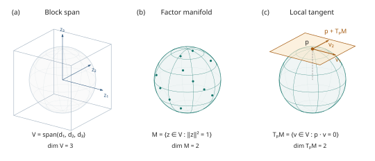

# Tangent-aware pruning: from layer reconstruction to downstream geometry

**Research article draft — 2026-11-08.** Mathematical formulation, scalable algorithms, and an evaluation protocol. Empirical superiority remains a hypothesis. This draft distinguishes exact identities from estimator and solver approximations; it does not present incomplete experiments as final results.

## Abstract

Layerwise pruning compresses a model by reconstructing each linear layer on calibration activations. SparseGPT makes this practical through approximate sparse reconstruction with compensating weight updates. We develop tangent-aware extensions by changing which activation errors the reconstruction should emphasize. Input-side methods preserve responses to meaningful activation differences. Output-side methods emphasize sample-dependent tangent and presence directions, with a scalable approximation that rescales weights before the SparseGPT solve. Downstream methods pull these geometric metrics backward through the network and couple them to local activations. This progression separates the geometry being protected from the approximation used to choose a sparse matrix. The resulting methods preserve ambient reconstruction as a baseline objective; their value must be established through held-out behavioral retention at measured compression, beyond improvements in the geometric objective itself.

## 1. Introduction

The manifold hypothesis posits that high-dimensional data concentrate near low-dimensional manifolds. A related hypothesis is that learned representations reflect the geometry of the underlying factors that generate the data. Recent work on large language models provides evidence for this correspondence in controlled tasks, reporting approximately proportional intrinsic distances between fitted activation and behavioral manifolds. These findings support an approximate, scaled isometry in the studied settings, rather than a universal equivalence between activation space and task space. [Wurgaft et al., 2026](https://arxiv.org/html/2605.05115v1)

Motivated by this evidence and by block-sparse models of representation, we hypothesize that activations admit a sparse additive decomposition into factor contributions, each varying locally on a smooth, low-dimensional manifold. Under this hypothesis, controlled changes in an isolated factor generate activation velocities that lie in its tangent space. We investigate whether this local geometry can guide the pruning of large language models: removing weights whose deletion, after compensation, minimally perturbs selected factor contributions and their responses to variation. Our objective is to maximize sparsity while retaining task performance, using tangent-based reconstruction criteria as tractable approximations to the geometric properties we seek to preserve. [Fel et al., 2026](https://arxiv.org/html/2606.25234v1)

The presentation makes three contributions: a unified weight-space quadratic for input, local-output, and downstream geometric protection; a derivation of a scalable rescaling algorithm with its approximation boundaries; and an evaluation protocol that separates geometric validity from behavioral retention. Section 2 specifies the compression target and reconstruction baseline. Section 3 defines factor-local geometry. Sections 4–6 derive the method variants, Section 7 gives their implementation, and Section 8 defines the empirical tests. Appendices A–D supply derivations and conditional bounds; Appendix E records reproducibility requirements. These are contributions of formulation and analysis, not claims of priority over all related methods.

## 2. Problem formulation and reconstruction baselines

### 2.1 Compression objective and notation

Let \(\theta\) be the reference model and \(\hat\theta\) its pruned version. For a fixed evaluation protocol, define task accuracy \(\mathcal A(\theta)\) and measured removed-weight fraction \(s(\hat\theta;\theta)\). The practical objective is

\[
\max_{\hat\theta} s(\hat\theta;\theta)
\quad\text{subject to}\quad
\mathcal A(\theta)-\mathcal A(\hat\theta)\le\tau,
\]

with tolerance \(\tau\) selected before final evaluation. Dense accuracy is a reference to retain, not a score the pruned model must exceed. The reconstruction objectives below are tractable proxies for this constrained behavioral problem; no equivalence is assumed.

| Symbol | Meaning |
|---|---|
| \(W,\hat W,A=W-\hat W\) | Reference weights, sparse weights, and residual |
| \(\phi_n\in\mathbb R^{d_i}\) | Input to the selected linear map |
| \(P_n\), \(M_n\) | Geometric projector and PSD error metric |
| \(H_0\), \(\mathcal C\) | Shared input second moment and full weight curvature |
| \(s,t,u,k\) | Sequence, target position, anchor position, and anchor site |
| \(J_{k,s}\), \(B_s\) | Intervening Jacobian and pulled-back metric |
| \(\gamma,\alpha,\delta\) | Metric coefficient, relative trace strength, and ridge |

Expectations denote declared empirical averages unless a population distribution is specified. Calibration is teacher-forced at fixed inputs; free-generation behavior is evaluated separately. Model precision, token weighting, padding exclusions, and eligible matrices are part of the protocol. Weight-count sparsity is not a guarantee of inference speedup or storage savings without an appropriate sparse representation and kernel.

### 2.2 The baseline problem

Let a target linear layer have weights \(W\in\mathbb R^{d_o\times d_i}\), calibration inputs \(\phi_n\), and sparse candidate \(\hat W\). Write \(A=W-\hat W\) for the pruning residual and let \(\mathcal S\) specify the sparsity constraint. The baseline is

\[
\min_{\hat W\in\mathcal S}\mathcal L_{\rm amb}(A),
\qquad
\mathcal L_{\rm amb}(A)=\mathbb E_n\|A\phi_n\|_2^2
=\operatorname{tr}(AH_0A^\top),
\qquad H_0=\mathbb E_n[\phi_n\phi_n^\top].
\]

Each output row shares the same input second moment: writing row \(p\) of \(A\) as \(a_p^\top\), its contribution is \(a_p^\top H_0a_p\). The Hessian of this expression with respect to \(a_p\) is \(2H_0\). We use the term *curvature* for \(H_0\), absorbing this common factor of two into the objective convention. Correlations between input features appear in the off-diagonal entries and determine how one weight can compensate for another.

Empirical curvature can be singular. We use \(H=H_0+\delta I\), with \(\delta=\rho\operatorname{tr}(H_0)/d_i\) and \(\rho>0\), whenever the trace is positive. This adds \(\delta\|W-\hat W\|_F^2\): a ridge on the pruning residual, not weight decay toward zero. Zero-energy coordinates require an explicit support convention. Uniform rescaling of H and its damping leaves OBS compensation ratios unchanged. Scaled-coordinate damping is more subtle and is derived in Appendix C.2.

### 2.3 SparseGPT and the OBS compensation principle

[SparseGPT](https://proceedings.mlr.press/v202/frantar23a.html) solves an approximate sparse reconstruction problem using shared curvature and a columnwise sequence of pruning and compensation. Its second-order foundation is [Optimal Brain Surgeon](https://papers.neurips.cc/paper_files/paper/1992/hash/303ed4c69846ab36c2904d3ba8573050-Abstract.html), which predates SparseGPT.

For a current weight row \(w\), deleting coordinate \(q\) while allowing the other coordinates to compensate solves

\[
\min_{\Delta w}\Delta w^\top H\Delta w
\quad\text{subject to}\quad \Delta w_q=-w_q.
\]

Its solution and cost are

\[
\Delta w=-\frac{w_q}{[H^{-1}]_{qq}}H^{-1}e_q,
\qquad s_q^{\rm OBS}=\frac{w_q^2}{[H^{-1}]_{qq}}.
\]

Let \(C\) be upper triangular with \(H^{-1}=C^\top C\). SparseGPT uses the score and update

\[
s_{pq}=\frac{W_{pq}^2}{C_{qq}^2},
\qquad
W_{p,j}\leftarrow W_{p,j}-\frac{W_{pq}}{C_{qq}}C_{qj},\quad j\ge q.
\]

The update corresponds to restricted quadratic compensation over columns still available in the elimination order. It does not imply that the complete discrete mask is globally optimal. Blockwise mask selection and processing order are additional algorithmic choices; scores within a selected block may be computed before later compensation changes its weights.

### 2.4 Wanda as a related diagonal approximation

[Wanda](https://arxiv.org/abs/2306.11695) ranks weights within each output row by \(|W_{pq}|\|X_{q,:}\|_2\), without compensating updates. For one isolated deletion, the mean ambient reconstruction cost is

\[
I_{pq}^{\rm amb}=W_{pq}^2(H_0)_{qq}.
\]

Squared Wanda scores are proportional to this cost. Replacing the input curvature by its diagonal gives the same ranking in the OBS expression. This connects the criteria mathematically; Wanda is a related method rather than a historical derivative of SparseGPT.

The distinction matters below: predicting an isolated deletion's energy is easier than predicting its cost after other weights compensate.

## 3. Motivation: which activation variations should pruning preserve?

### 3.1 The local manifold assumption

Fix an activation site with ambient space \(\mathcal H=\mathbb R^d\). Our geometric hypothesis concerns the **isolated contribution of a factor**, rather than the full activation response to changing an input. These are different objects: a whole-activation response may include changes in several factors and their interactions.

**Assumption (smooth isolated-factor contributions).** Within a fixed active-factor regime and local branch, factor i contributes

\[
m_i=f_i(u_i),\qquad
f_i:\mathcal U_i\subset\mathbb R^{r_i}\longrightarrow\mathcal H,
\qquad f_i\in C^2,\qquad
\operatorname{rank}Df_i(u_i)=r_i\ll d.
\]

Here \(Df_i(u_i)\) is the differential of the factor parameterization: it maps a velocity in factor coordinates to a velocity in activation space. Its coordinate matrix is the Jacobian. Appendix B.6 defines the differential, the tangent and cotangent bases, and its distinction from a metric or connection.

The domain \(\mathcal U_i\) is open and represents continuous within-factor states. The image is locally a smooth immersed manifold \(\mathcal M_i\), with tangent \(\operatorname{im}Df_i(u_i)\); on a sufficiently small embedded patch the constructions below apply directly. The factor identity and coordinates are held consistent across contexts in which this model is asserted. Dependence on other factors that cannot be absorbed by this fixed contribution map is a violation or residual of the additive model, not automatically part of factor i's manifold. Distinct branches can have distinct parameterizations, as in Sec. 3.2.

This is an assumption about latent factor contributions, not a claim that an arbitrary sequence of token substitutions is smooth. Discrete interventions provide samples of a hypothesized continuous factor state. The hypothesis does not imply that the union over active sets is one smooth manifold, or that the factor contributions are identifiable from their sum. In particular, the fitted decomposition \(D_i z_i(h)\) is an estimate of \(m_i\), not a guarantee of its recovery.

Let \(\iota:\mathcal M\hookrightarrow\mathcal H\) be the inclusion and \((\mathcal U,\psi)\) a chart, with \(\psi:\mathcal U\to\Omega\subset\mathbb R^r\). The associated local parameterization is \(f=\iota\circ\psi^{-1}\). At \(h=f(u)\), its differential identifies the tangent space with an ambient linear subspace:

\[
d\iota_h(T_h\mathcal M)=\operatorname{im}Df(u),
\qquad \operatorname{rank}Df(u)=r.
\]

We use \(T_h\mathcal M\) for this embedded tangent space when the identification is unambiguous. The Euclidean inner product on \(\mathcal H\) induces the Riemannian metric \(g=\iota^*\langle\cdot,\cdot\rangle\), whose coordinate matrix is \(g_u=Df(u)^\top Df(u)\). The ambient orthogonal projector onto the tangent space is

\[
P_h=Df(u)\,g_u^{-1}\,Df(u)^\top=Q_hQ_h^\top,
\]

where \(Q_h\) is any Euclidean-orthonormal tangent frame. The projector is independent of chart coordinates and of the chosen orthonormal frame, although its diagonal entries depend on the ambient coordinate basis. Curvature permits \(T_h\mathcal M\) to vary with \(h\); replacing these spaces by a fixed global span is an additional approximation.

### 3.2 Factor structure across multiple local manifolds

A useful local composition model is

\[
h=b+\sum_{i\in S}f_{i,c_i}(u_i)+\epsilon,
\qquad
\mathcal M_{S,c}=\left\{b+\sum_{i\in S}f_{i,c_i}(u_i)\right\}.
\]

Here S is the active factor set and c_i indexes a local branch or chart of factor i. Across active sets and branches the support is a union of such compositions, not one global linear space. At a regular point of the additive map, its differential has image \(\sum_{i\in S}\operatorname{im}Df_{i,c_i}(u_i)\). The dimension is the rank of the concatenated differentials, not necessarily the sum of factor dimensions. Constant rank in a neighborhood permits a local immersed-manifold interpretation; intersections or changing rank require separate regimes.

The factor's global linear container \(V_i=\operatorname{span}(\mathcal M_i-b_i)\) can be much larger than its tangent at a particular point. Protecting V_i, protecting a local tangent, and pooling all factor spans are different hypotheses. Our factor dictionary and local PCA approximate this structure without proving identifiability or recovering the paper-level BSF model. Appendix B derives the projection and finite-difference interpretations used here.

Figure 1 distinguishes the factor's linear span, the manifold of its states, and a tangent space at one state.



**Figure 1. Factor span, manifold, and local tangent space.** **(a)** A factor block spans a three-dimensional linear space \(V=\operatorname{span}(d_1,d_2,d_3)\), shown through a finite cubic window; the faint sphere provides a reference. **(b)** In this schematic example, factor states occupy the unit sphere \(\mathcal M=\{z\in V:\|z\|^2=1\}\), a two-dimensional surface rather than the enclosed ball. Dots illustrate possible states, not empirical measurements. **(c)** At \(p=(0,0,1)\), the two-dimensional tangent space is \(T_p\mathcal M=\{v\in V:p^\top v=0\}\). The orange patch depicts its affine translate \(p+T_p\mathcal M\), with two independent tangent vectors drawn from p. The tangent orientation varies around the sphere, whereas the block span remains fixed. All panels use the same orthographic projection and an orthonormal block coordinate system. This example illustrates the geometric distinction; it does not assume that learned factors are spherical.

### 3.3 Estimating directions and using them in pruning

Block-sparse featurization estimates factor subspaces and sample-dependent coordinates within them. The observed factor contributions provide empirical samples of the hypothesized manifolds, but do not directly specify their local tangent spaces or a smooth atlas. We estimate these additional local structures from neighborhoods of each factor’s contributions. For the factor-local estimator, write the inferred contribution of factor i to fitting sample n as \(m_{i,n}=D_i z_i(h_n)\in\mathbb R^d\), and use only samples on which that factor is active. Partition these contributions into local neighborhoods \(\mathcal I_{i,c}\). For each neighborhood, form its mean and centered covariance,

\[
\bar m_{i,c}=\frac{1}{N_{i,c}}\sum_{n\in\mathcal I_{i,c}}m_{i,n},
\qquad
\widehat C_{i,c}=\frac{1}{N_{i,c}}\sum_{n\in\mathcal I_{i,c}}
(m_{i,n}-\bar m_{i,c})(m_{i,n}-\bar m_{i,c})^\top,
\]

where \(N_{i,c}=|\mathcal I_{i,c}|\). Let \(Q_{i,c}\) contain the leading r orthonormal eigenvectors of \(\widehat C_{i,c}\), provided the neighborhood supports the requested rank. These directions minimize the local rank-r affine reconstruction error. For a new activation h, assign each active factor to its nearest fitted neighborhood center and combine only those local frames:

\[
c_i(h)=\arg\min_c\|D_i z_i(h)-\bar m_{i,c}\|_2^2,
\qquad
Q(h)=\operatorname{orth}\!\left([Q_{i,c_i(h)}]_{i\in S(h)}\right),
\qquad \widehat P(h)=Q(h)Q(h)^\top.
\]

Here unsupported factors contribute no columns, and \(\operatorname{orth}\) removes linearly dependent directions. Neighborhoods are fitted k-means cells, so this is a piecewise-constant tangent estimate, not a new PCA fit at every query. A whole-activation baseline applies the same centered-PCA construction directly to neighborhoods of h, without factor decomposition. Appendix B.4 derives the estimator, its efficient factor-coordinate implementation, and the assumptions needed to interpret its principal directions as tangents.

These neighborhood models constitute an empirical atlas only in an approximate sense: the implementation does not recover transition maps or establish smooth compatibility on chart overlaps. Tangent estimation depends on neighborhood scale, sampling density, curvature, noise, and separation of co-active factors; stability and held-out approximation error must be measured.

At sample \(n\), let \(Q_n\in\mathbb R^{d\times r_n}\) be an estimated orthonormal frame and \(P_n=Q_nQ_n^\top\). The splitting \(\mathcal H=T_{h_n}\mathcal M\oplus N_{h_n}\mathcal M\) decomposes a pruning error \(e_n\) into tangential and normal components. The penalty \(\|P_ne_n\|_2^2\) emphasizes its tangential component in the induced metric. It does not constrain the normal component or imply preservation of intrinsic distances, curvature, or downstream behavior. Frame estimates should be distinguished from the exact tangent spaces in this interpretation.

For co-active factors, let \(E_{i,n}\subset\mathcal H\) be their estimated tangent subspaces after mapping them into the same activation space. Protect the sum \(E_n=\sum_{i\in S_n}E_{i,n}\) using an orthonormal frame for that sum. Its dimension can be smaller than the sum of factor dimensions. Identifying \(E_n\) with the tangent of a joint factor manifold additionally requires a compatible local composition model; a product-manifold or direct-sum decomposition is not assumed automatically.

Tangential variation also need not encode factor presence. Given a chart anchor \(\bar h_n\) and an explicit concept-absent reference \(h_n^{(0)}\), the ambient offset \(a_n=\bar h_n-h_n^{(0)}\) can have a component \((I-P_n)a_n\) normal to the protected tangent sum. When nonzero, its normalized direction augments the protected subspace to account for attenuation toward that reference. This is an extrinsic, reference-dependent construction, not a canonical intrinsic tangent vector. Denote the projector onto the augmented span by \(P_n^{\rm geo}\). Without an absent reference, retain the tangent-only interpretation.

These projectors define selected directions in activation space, not an established semantic decomposition. Local charts should be compared with fixed factor spans, a global union, and shuffled assignments on held-out data. A geometry objective that ignores the complementary space can allow arbitrarily large unmeasured errors there. We therefore add geometric terms to ambient reconstruction.

The site must also be explicit: a projection output, post-MLP residual, and normalized residual are different spaces. Geometry measured at one site applies to another only through a specified intervening map.

### 3.4 Tangents from controlled isolated-factor trajectories

Under the assumption in Sec. 3.1, a differentiable path \(u_i(t)\) induces an isolated-factor trajectory and velocity

\[
m_i(t)=f_i(u_i(t)),\qquad
\dot m_i(t)=Df_i(u_i(t))\dot u_i(t)
\in T_{m_i(t)}\mathcal M_i.
\]

At a common factor state u, choose control velocities \(a_1,\ldots,a_k\in\mathbb R^{r_i}\). Their activation velocities form

\[
V_i(u)=\left[Df_i(u)a_1\;\cdots\;Df_i(u)a_k\right].
\]

If the controls span \(\mathbb R^{r_i}\), then \(\operatorname{im}V_i(u)=T_{f_i(u)}\mathcal M_i\), and \(Q_i(u)=\operatorname{orth}(V_i(u))\) supplies a tangent frame without neighborhood PCA. One trajectory identifies at most one direction at a point. Velocities measured at different points generally belong to different tangent spaces and cannot be pooled as if they were one frame without a local approximation or an explicit alignment.

Isolation is essential. Along an observed intervention,

\[
\dot h=\sum_{j\in S}Df_j(u_j)\dot u_j+\dot\epsilon.
\]

A whole-activation velocity equals the isolated velocity of factor i only when the other contributions and residual remain fixed. Otherwise, use a separately validated factor extraction or a justified decomposition of the intervention response. Freezing that extractor establishes a consistent measurement convention but does not prove that the factor has been isolated. Appendix B.5 develops finite-difference estimation and the corresponding response-preservation objective.

## 4. Input-side geometry: augment the shared curvature

The simplest extension protects responses to meaningful changes in the layer input. For aligned paired inputs, define \(t_k=\phi(x_k')-\phi(x_k)\) and \(H_\Delta=\mathbb E_k[t_kt_k^\top]\). Then

\[
\mathcal L_{\rm in}(A)
=\mathbb E_n\|A\phi_n\|_2^2
+\gamma_{\rm in}\mathbb E_k\|At_k\|_2^2
=\operatorname{tr}\bigl(A(H_0+\gamma_{\rm in}H_\Delta)A^\top\bigr).
\]

This changes the shared input curvature, so the existing SparseGPT solve applies directly after augmentation and damping. Explicit input tangent probes can replace paired differences. Finite differences capture the chosen paired intervention; they approximate a tangent only at appropriate step sizes and alignments.

Set the added-to-ambient trace ratio through

\[
\gamma_{\rm in}=\alpha_{\rm in}
\frac{\operatorname{tr}(H_0)}{\operatorname{tr}(H_\Delta)}.
\]

Thus \(\alpha_{\rm in}\) is a ratio to ambient curvature; its fraction of the augmented trace is \(\alpha_{\rm in}/(1+\alpha_{\rm in})\). Normalize heterogeneous intervention families explicitly and disable or reject zero-energy terms.

For a linear layer, \(At_k\) is exactly the error in its local response difference. For a gate or upstream projection, it is a preactivation error; behavior after nonlinearities requires further analysis or a downstream pullback.

### 4.1 Reformulation as preservation of isolated-factor responses

Tangent directions can be used in two ways: to project a pruning error, as in Sec. 5, or to compare how the dense and pruned models respond along a factor trajectory. For the second construction, let \(m_i(u)\) and \(\widehat m_i(u)\) denote their isolated contributions in the same activation space, with matched factor identity, coordinate u, and a fixed extraction convention. Define

\[
\mathcal L_{\rm response}
=\mathbb E_{i,u,a}\left\|
\bigl(D\widehat m_i(u)-Dm_i(u)\bigr)a
\right\|_2^2.
\]

Here a is a declared control velocity, with conditional second moment \(C_i(u)=\mathbb E[aa^\top\mid i,u]\). Its distribution specifies which changes matter and with what strength. The two models must be compared at the same factor state; separately refitting their factor dictionaries or reparameterizing one model can conceal a changed response. For a hard-assignment factor extractor, differentiability is only asserted inside a fixed assignment regime.

For a linear layer with frozen upstream inputs, impose the isolated input contribution \(\phi_i(u)=f_i^{\rm in}(u)\). Its additive output contribution is \(m_i(u)=W\phi_i(u)\), and the pruned contribution is \(\widehat m_i(u)=\widehat W\phi_i(u)\). With \(A=W-\widehat W\) and \(v_i=D\phi_i(u)a\),

\[
\bigl(D\widehat m_i-Dm_i\bigr)a=-A v_i,
\qquad
H_{\rm trajectory}=\mathbb E_{i,u,a}[v_i v_i^\top],
\]
\[
\mathcal L_{\rm ambient}+\gamma_{\rm trajectory}\mathcal L_{\rm response}
=\operatorname{tr}\!\left[A
(H_0+\gamma_{\rm trajectory}H_{\rm trajectory})A^\top\right].
\]

Thus isolated-factor velocity preservation reduces **exactly** to input-curvature augmentation under these local linear and frozen-input assumptions. Section 4's trace normalization applies with \(H_\Delta\) replaced by \(H_{\rm trajectory}\). Using raw velocities preserves their control-dependent magnitudes; orthonormalizing them instead defines an equally weighted span metric, which is a different objective.

At nonlinear downstream sites, the response derivative also changes through the intervening Jacobian. The frozen-J construction of Sec. 6.5 approximates part of that change; it is not an exact implementation of \(\mathcal L_{\rm response}\). Likewise, penalizing \(\|P_i(\widehat m_i-m_i)\|^2\) measures the tangential component of a pointwise error, not agreement of response derivatives. Neither penalty generally determines the other. A response-only loss also misses constant offsets, so ambient reconstruction or explicit reference-state matching remains necessary.

This formulation introduces a proposed source of tangent probes and a corresponding scientific target. Existing paired-input and input-basis solvers provide related quadratic machinery; they do not by themselves establish controlled isolation, smooth factor trajectories, or preservation of those trajectories in a language model.

## 5. Local output geometry: sample-dependent reconstruction metrics

The input-side method is a special case of a broader PSD quadratic. With row-major vectorization \(a=\operatorname{vec}_r(A)\), local output metrics produce

\[
\mathcal L(A)=a^\top\mathcal C a,
\qquad \mathcal C=\mathbb E_n[M_n\otimes(\phi_n\phi_n^\top)].
\]

Input augmentation changes the second factor of the ambient Kronecker product; local output geometry makes the first factor sample-dependent; downstream propagation replaces the local map by a sequence-level operator. Appendix A derives this representation, its matrix-free action, and exact fixed-mask refits. The key computational obstacle is that general \(\mathcal C\) couples output rows, while SparseGPT relies on a shared input curvature.

### 5.1 Objective and direct deletion scores

For a layer writing into the geometric site, use

\[
\mathcal L_{\rm out}(A)
=\mathbb E_n\|A\phi_n\|_2^2
+\gamma\mathbb E_n\|P_n^{\rm geo}A\phi_n\|_2^2.
\]

This replaces the output identity metric by \(M_n=I+\gamma P_n^{\rm geo}\). An isolated deletion has geometric energy

\[
I_{pq}^{\rm geo}
=W_{pq}^2\mathbb E_n[(P_n^{\rm geo})_{pp}\phi_{qn}^2].
\]

Define the activation-conditioned coupling

\[
G_{pq}=\frac{\mathbb E_n[(P_n^{\rm geo})_{pp}\phi_{qn}^2]}
{\mathbb E_n[\phi_{qn}^2]}.
\]

It combines output-coordinate participation with input-feature activity on the same examples. An average projector computed before this pairing loses that dependence. These direct energies motivate mask scores but do not include compensation.

### 5.2 From the coupled objective to a scalable solve

The full output metric couples weight rows. Dropping its off-diagonal entries gives a separate curvature for each output row:

\[
H^{(p)}=H_0+\gamma\mathbb E_n[(P_n^{\rm geo})_{pp}\phi_n\phi_n^\top].
\]

Approximate each row curvature by a diagonal congruence of one shared curvature \(H'\):

\[
H^{(p)}\approx\Lambda_pH'\Lambda_p,
\qquad \lambda_{pq}^2=\frac{H^{(p)}_{qq}}{H'_{qq}}.
\]

For \(H'=H_0\), this gives \(\lambda_{pq}^2=1+\gamma G_{pq}\). The corresponding algorithm is

```text
Estimate sample-paired geometric moments and shared ambient curvature.
Match row-curvature diagonals to obtain positive scales Λ.
Run SparseGPT on W_scaled = W ⊙ Λ with the shared curvature.
Return W_pruned = W_scaled_pruned ⊘ Λ.
```

For a different shared curvature, the entire row diagonal must be divided by
the shared diagonal: \(\lambda_{pq}^2=((H_0)_{qq}/H'_{qq})(1+\gamma G_{pq})\).
This includes the ambient term even when \(\gamma=0\).

We normalize geometric strength by its weight-curvature trace. For \(K_{pq}=\mathbb E_n[(P_n^{\rm geo})_{pp}\phi_{nq}^2]\), set

\[
\gamma=\alpha\frac{d_o\operatorname{tr}(H_0)}{\sum_{p,q}K_{pq}}.
\]

This fixes the added-to-ambient trace ratio before damping on supported coordinates. It is not the same as normalizing by average projector rank: readout energy and rank can be correlated (Appendix C.3). Zero geometric trace disables the added term; absent supported geometry must be reported. With geometry measured only at readouts, define it as zero at other ambient samples and use an explicit common averaging denominator. Implementation correspondence and legacy distinctions are collected in Appendix E.

The scale changes both selection and compensation:

\[
s_{pq}=\lambda_{pq}^2\frac{W_{pq}^2}{C_{qq}^2},
\qquad
\Delta W_{pj}=-W_{pq}\frac{\lambda_{pq}}{\lambda_{pj}}\frac{C_{qj}}{C_{qq}}.
\]

Multiplying scores alone omits the matching update and remains a heuristic ablation. Unsupported input coordinates keep unit scale and are reported.

There are two distinct approximations: removing output coupling and replacing row curvatures by shared congruences. Damping adds another qualification. Standard damping in scaled coordinates induces \(\delta\Lambda_p^2\) in original coordinates, so it is not generally equivalent to adding \(\delta I\) to each intended row curvature. The implemented solve must be evaluated as that damped surrogate.

### 5.3 When reweighting can change a mask

A fixed output metric produces constant row factors in this approximation. They can redistribute deletions across rows under blockwise unstructured selection, but cancel in row-local Wanda or N:M comparisons. Sample-conditioned geometry can vary within a row through its coupling with input activity. The comparison group and observed mask changes must therefore be reported.

Coordinate leverages are basis-dependent and can vary substantially even for random subspaces. Random-looking leverage distributions or random-control-like mask-flip rates do not establish usefulness or failure. The relevant test is held-out impact prediction and pruning behavior against matched controls.

### 5.4 References beyond row-diagonal approximation

For a fixed mask, the full sample-dependent objective is a convex quadratic. Matrix-free products use \(\mathbb E_n[M_nA\phi_n\phi_n^\top]\); solving its free-coordinate normal equations provides a reference refit, subject to numerical convergence. Small problems can explicitly construct the quadratic to measure approximation error.

A complementary construction uses a fixed global union projector \(\Pi=QQ^\top\). Starting from ambient sparse weights \(W_{\rm sp}\), restore

\[
\hat W=W_{\rm sp}+\Pi(W-W_{\rm sp}).
\]

This cancels error in that fixed union but adds a dense low-rank correction. It is sparse-plus-low-rank compression, with its full storage counted, and does not reproduce sample-dependent chart selection.

## 6. Downstream geometry: pull back an error metric, not tangent vectors

### 6.1 Specify the intervention and the sequence-level map

Tangent vectors propagate **forward** by a Jacobian: a local tangent frame \(U\) has downstream image \(\operatorname{span}(JU)\), possibly with reduced rank. The construction below instead propagates **covectors backward** and pulls back a quadratic metric. \(J^\top V\) is generally neither an orthonormal tangent frame nor the inverse image of a downstream manifold. Orthogonalizing it would discard the downstream amplification that the metric is meant to retain.

Index independent calibration sequences by \(s\), target token positions by \(t\), and downstream anchor positions by \(u\). Stack the target outputs into \(y_s\), and write the anchor state as \(h_{k,s}=F_{k\leftarrow\ell,s}(y_s)\). This is an intervention map: other incoming branches, attention masks, position information, and reference inputs are held fixed. The map must include every path from the selected target output to the anchor; the output of a gate projection, an MLP down projection, and a residual state are different intervention sites.

At a frozen reference forward, define

\[
J_{k,s}=D_yF_{k\leftarrow\ell,s}(y_s),\qquad
D_{k,s}=\operatorname{blockdiag}_u(\omega_{k,s,u}P^{\rm geo}_{k,s,u}),
\qquad \omega_{k,s,u}\ge0.
\]

The token-block-diagonal choice for D is an **anchor-metric modeling choice**, not an assertion that the network is token-local. If geometry describes a joint sequence manifold, use a joint sequence metric instead. Weights specify whether anchors are summed, averaged, or reweighted; padding must receive zero weight. For geometric frames \(V\) with orthonormal columns, \(P=VV^\top\). More generally any declared positive-semidefinite D can be used.

For the shared matrix residual \(A=W-\hat W\), define the linear operator

\[
T_s(A)=\operatorname{stack}_t(A\phi_{s,t}).
\]

Replacing \(W\) by \(\hat W\) perturbs the target output by \(-T_s(A)\), assuming its input is held fixed during this layer's reconstruction. The downstream change is

\[
\delta h_{k,s}=-J_{k,s}T_s(A)+O(\|T_s(A)\|^2).
\]

This expansion requires a differentiable intervening map with controlled local derivatives. At a support boundary, hard routing change, or sufficiently large perturbation it need not predict the finite change accurately. The frozen geometric penalty is

\[
B_s=\sum_k\beta_kJ_{k,s}^{\top}D_{k,s}J_{k,s},\quad \beta_k\ge0,
\qquad
\mathcal L_{\rm down}(A)=\mathcal L_{\rm amb}(A)
+\gamma\mathbb E_s[T_s(A)^\top B_sT_s(A)].
\]

B is PSD but usually not a projector. Its nullspace includes errors invisible to the selected downstream measurements, including errors mapped into unprotected normal directions. This is why ambient reconstruction remains in the objective. It is a frozen geometric/Gauss–Newton-style surrogate, not the exact Hessian of task loss and not a guarantee of GSM8K retention. A finite-change geometric discrepancy with fixed D agrees to quadratic order under the stated smoothness assumptions.

### 6.2 Shared weights require token cross terms

Partition \(B_s\) into blocks \(B_{s,tt\prime}\in\mathbb R^{d_o\times d_o}\). The exact geometric quadratic for the frozen model is

\[
\mathbb E_s\sum_{t,t'}(A\phi_{s,t})^\top B_{s,tt'}(A\phi_{s,t'}).
\]

The same A acts at every token. Consequently, retaining a full downstream Jacobian but dropping cross-token entries of B still changes the weight objective. For one deletion \(A=W_{pq}e_pe_q^\top\), the exact geometric energy is

\[
I^{\rm down}_{pq}=W_{pq}^2\mathbb E_s\sum_{t,t'}
\phi_{s,t,q}(B_{s,tt'})_{pp}\phi_{s,t',q}.
\]

It is generally **not** \(W_{pq}^2\mathbb E_s\sum_t b_{s,t,p}\phi_{s,t,q}^2\). Cross-token contributions may reinforce or cancel; removing them is neither a general upper nor lower bound. For a scalar output shared over two tokens with \(\phi_1=\phi_2=1\) and \(A=a\), consider

\[
B_-=\begin{pmatrix}1&-1\\-1&1\end{pmatrix},\qquad
B_+=\begin{pmatrix}1&1\\1&1\end{pmatrix}.
\]

Both are PSD. The exact energies are respectively zero and \(4a^2\), whereas replacing either matrix by its diagonal gives \(2a^2\).

The full weight-space geometric curvature operator is \(\mathbb E_s[T_s^*B_sT_s]\), where \(T_s^*(g)=\sum_t g_t\phi_{s,t}^\top\) is the Frobenius adjoint. This operator, plus ambient curvature and explicitly specified damping, is the appropriate fixed-mask reference. It also makes clear why tokenwise diagonalization and weight-space diagonalization are different approximations.

### 6.3 VJPs: what is unbiased, and what is discarded

Factor \(D_{k,s}=L_{k,s}L_{k,s}^\top\). Draw zero-mean \(r\) with \(\mathbb E[rr^\top]=I\) and form

\[
v_{k,s}=L_{k,s}r,\qquad g_{k,s}=J_{k,s}^{\top}v_{k,s},\qquad
\mathbb E_r[g_{k,s}g_{k,s}^{\top}]=J_{k,s}^{\top}D_{k,s}J_{k,s}.
\]

For token-local frames, \(L\) has blocks \(\sqrt{\omega_u}V_u\). Independent coefficients at different positions encode the specified block-diagonal anchor metric; reusing coefficients across positions introduces a different metric with cross-position terms. Multiple anchors can be estimated separately with \(\beta_k\) weights, or combined using independent zero-mean seeds scaled by \(\sqrt{\beta_k}\). Shared seeds without a specified covariance introduce unwanted cross-anchor terms.

Compute each VJP from the scalar inner product of stopgrad(v) with h_k. Freeze bases, chart assignments, anchor weights, and reference states for the quadratic solve. Parameters need no accumulated gradient buffers, but the computational graph from target output to anchor must remain intact. In a joint multi-target forward, detaching an intermediate target can sever paths required by an earlier target; a separate forward per target avoids that error.

Averaging g-coordinate squares estimates diag(B), not the complete weight-space curvature. Enumerating all columns of L gives this diagonal exactly up to numerical precision. To estimate the **exact shared-weight curvature diagonal**, first form

\[
Z_{k,s}=T_s^*(g_{k,s})=\sum_t g_{k,s,t}\phi_{s,t}^{\top},
\qquad
K^{\rm full}_{pq}=\mathbb E_s\sum_k\beta_k\mathbb E_r[(Z_{k,s})_{pq}^2].
\]

Summing over tokens **before squaring** retains token interference. Summing squared token contributions instead gives the activation-diagonal surrogate in Sec. 6.4. The full weight diagonal still omits off-diagonal compensation interactions and does not by itself define an exact SparseGPT solve. Exact matrix-free products can instead apply T, J, D, J-transpose, and T* in sequence.

Unbiasedness holds conditional on the frozen forward and geometry, before normalization. With finitely many probes, trace-normalizing an estimated K is a nonlinear operation: the resulting normalized metric/scales are not generally unbiased. Report probe-seed variability and convergence, especially after mask selection.

### 6.4 The implemented scalable surrogate and its normalization

The original downstream accumulator (`metric="activation_diagonal"`, retained as an ablation) keeps

\[
b_{s,t,p}=(B_s)_{(t,p),(t,p)},\qquad
K_{pq}=\mathbb E_s\sum_t b_{s,t,p}\phi_{s,t,q}^2,
\qquad
H^{(p)}=H_0+\gamma\mathbb E_s\sum_t b_{s,t,p}\phi_{s,t}\phi_{s,t}^{\top}.
\]

Here \(H_0=\mathbb E_s\sum_t\phi_{s,t}\phi_{s,t}^\top\) uses the same sequence-sum convention. A token-average convention is also valid if declared consistently. First, activation-space diagonalization removes output-coordinate and token correlations; second, the congruence approximation of Sec. 5 replaces the resulting row curvatures by scaled copies of a shared H_0; third, SparseGPT approximates the sparse solve. None of these steps follows from the unbiased VJP identity alone.

For the diagonal surrogate define

\[
\gamma=\alpha\frac{d_o\operatorname{tr}(H_0)}{\sum_{p,q}K_{pq}},
\qquad \lambda_{pq}^2=1+\gamma K_{pq}/(H_0)_{qq}.
\]

This matches the added **surrogate weight-curvature trace**, not projector rank or the full downstream curvature trace. Local ambient and backward samples must remain paired within K, but their budgets can differ. Concretely, with ambient sums \(S_q\) and geometric sums \(G_{pq}\), the code uses \(\gamma_{\rm sum}=\alpha d_o\sum_q S_q/\sum_{pq}G_{pq}\) and \(\lambda_{pq}^2=1+\gamma_{\rm sum}G_{pq}/S_q\). If their averaging denominators are \(N_a\) and \(N_g\), the corresponding mean-convention coefficient is \(\gamma_{\rm mean}=\gamma_{\rm sum}N_g/N_a\). Record the convention; do not interpret a raw-sum gamma as budget-independent.

The code excludes unsupported ambient coordinates from normalization and assigns them unit scale, and disables a zero-trace added term. Report excluded geometric energy: this choice does not protect a geometry-only input coordinate. Preserve relative anchor weights before global normalization; separately trace-normalizing each anchor specifies a different objective. Scaled-coordinate damping has the original-coordinate penalty described in Sec. 5.2.

The implemented `metric="weight_diagonal"` variant accumulates the shared-weight diagonal of Sec. 6.3: form \(Z=g^\top X\) within each independent sequence and probe, then accumulate \(Z\odot Z\). Average probes and sum independent sequences and weighted anchors after squaring. This retains token cancellation and reinforcement. Normalize by this statistic's own supported trace and use the same diagonal-matching scales; row-congruence compensation remains approximate. Input-tangent coupling is now supported with separately normalized moments and an explicit sequence covariance (Sec. 6.5). Diagnostics report raw, excluded and supported geometric mass and achieved trace ratios. The GSM8K geometric-arm guard checks supported geometry after finalization. Current GSM8K drivers use the verified reference backend; the historical backend helper remains separate.

### 6.5 Optional two-sided tangent response: a distinct approximation

For a single-position input perturbation with frame \(U\) and covariance \(R=UU^\top\), the frozen response penalty is

\[
\eta\operatorname{tr}(BA R A^{\top})
=\eta\sum_k\beta_k\|L_k^{\top}J_k A U\|_F^2.
\]

For sequences, input tangent probes must specify their joint token structure: for a probe \(\xi=\operatorname{stack}_t\xi_t\), use \(T_\xi(A)=\operatorname{stack}_t A\xi_t\) and \(\mathbb E_\xi[T_\xi(A)^\top BT_\xi(A)]\). Independent token probes and correlated whole-sequence probes are different choices. Under independent token coefficients, the accumulated weight diagonal is \(\eta\mathbb E_s\sum_t b_{s,t,p}(R_{s,t})_{qq}\). With shared direction coefficients, instead form \(Z_r=\sum_t g_t u_{t,r}^\top\) before squaring. Both choices are implemented for shared-weight calibration; only independent token coefficients apply to activation-diagonal calibration. The driver fits input charts on geometry-fit readouts, and shared directions use a declared Procrustes alignment to a frozen fit-only dictionary frame. The two moment traces receive separate curvature shares. See [implementation and sequence conventions](two-sided-full-metric-implementation.md).

This term controls the contribution from changing W while **freezing the downstream Jacobian**. It is not the full change in the downstream tangent-transfer map. With input frame \(U\) fixed, \(y=W\phi\), perturbation \(\Delta W\), and transfer \(J(y)WU\), its first variation is

\[
\delta[J(y)WU]
=J(y)\Delta W U
+\bigl(D_yJ(y)[\Delta W\phi]\bigr)WU.
\]

The second term involves downstream second derivatives. Changes to U, downstream geometry/assignments, or upstream inputs add further terms. Thus even infinitesimal weight changes need not justify dropping this term: it is also first order in \(\Delta W\). The approximation needs a nearly constant downstream Jacobian or an empirical bound on the omitted contribution. A meaningful finite-difference check compares the complete transfer change against the frozen-J prediction.

Factor-local geometry must remain sample- and factor-dependent in every construction above. Push each co-active factor's tangent through the specified map before forming its image span; distinct regions may have different frames or ranks. If measuring downstream sensitivity, pull back each declared downstream metric and sum with explicit weights instead. A global union or a pooled covariance erases some of this conditioning and is a baseline, not an equivalent representation of a union of local factor manifolds.


## 7. Algorithms and implementation scope

The techniques form the following progression. Each row changes the objective or its representation; none implies a demonstrated empirical improvement.

| Technique | Additional information | Computational change |
|---|---|---|
| Ambient SparseGPT | Local input second moment | Shared curvature and compensating updates |
| Input-side augmentation | Paired differences or input tangent probes | Add shared input curvature |
| Local output geometry | Sample-conditioned tangent/presence projectors | Approximate row curvatures; rescale weights and compensation |
| Downstream pullbacks | Downstream geometry and intervening VJPs | Backward calibration, then the same approximate row solve |
| Two-sided tangent coupling | Local input tangents plus downstream metric | Add paired geometric curvature moments |
| Full-metric refit | Retained output/token correlations | Coupled fixed-mask quadratic solve; small reference problems |

### 7.1 Sequential calibration and pruning

**Inputs:** reference model, ordered target matrices, fitting/calibration splits, anchor definitions, sparsity constraints, trace strengths, probe budget, and a fixed generation/evaluation protocol.

```text
for each target matrix W in the declared order:
    freeze the current partially pruned model as this target's reference
    fit or refresh factor-local frames on fitting examples at declared sites
    collect the matched ambient inputs and construct H0
    estimate sample-paired local metrics or frozen-anchor VJP statistics
    compute supported geometric curvature diagonals K
    normalize the added trace and construct positive scales Λ
    prune W ⊙ Λ using the declared shared curvature and damping
    replace W by the unscaled sparse result
    persist the candidate, effective objective, diagnostics, and reference identity
evaluate frozen candidates on validation; select the retention frontier
freeze the selected configurations before final held-out evaluation
```

The mask and compensating weights are both outputs of the solve. Activation refresh is required for the stated sequential reference convention; reusing dense-model samples is a distinct approximation. Geometry fitting and calibration must exclude final evaluation examples. Chart assignments depend on the reference forward, then remain fixed during the target's quadratic optimization.

### 7.2 Computational requirements

For input dimension \(d_i\) and output dimension \(d_o\), shared-curvature pruning stores \(O(d_i^2)\) curvature plus \(O(d_od_i)\) weights and scales. Dense factorization costs \(O(d_i^3)\), and elimination/compensation typically costs \(O(d_od_i^2)\), aside from calibration. Independent exact row curvatures would require up to \(O(d_od_i^2)\) storage and \(d_o\) factorizations, motivating the common-curvature approximation.

For N geometric samples, accumulating \(K\) from projector diagonals and input squares costs \(O(Nd_od_i)\) arithmetic and can be streamed or blocked. Low-rank frames avoid storing \(N\) full output projectors. Downstream calibration additionally requires backward computation for each probe and an activation graph through the declared anchor window. Random probes replace enumeration of all anchor directions but introduce estimator variance. A matrix-free exact refit avoids a dense \((d_od_i)\)-square matrix; its practical cost depends on the number and conditioning of iterative solves and repeated Jacobian products. It is not automatically cheaper than the surrogate.

### 7.3 Implementation boundary

Backward calibration requires activation memory and backward-compatible kernels. Stopping forwards at bounded anchors limits memory and defines the scope of the metric. It does not make a bounded-anchor experiment equivalent to a full-network metric. The implementation supports frozen models without changing parameter gradient buffers; hard-mask selection remains outside differentiation.

Bias correction can be represented by an appended constant input for ambient reconstruction. With sample-dependent output metrics, exact weighted bias correction requires the corresponding coupled normal equations; a row-diagonal solver remains an approximation. Input differences cancel constant offsets automatically.

| Component | Repository implementation |
|---|---|
| Ambient SparseGPT; Wanda | `src/sparsifier/prune/sparsegpt.py`; `wanda.py` |
| Shared input augmentation | `src/sparsifier/prune/input_side.py` |
| Matched rescaling and compensation | `src/sparsifier/prune/rescale.py` |
| Chart bases, VJPs, downstream calibration and solve | `src/sparsifier/prune/downstream.py` |
| Small coupled quadratic/refit reference | `src/sparsifier/prune/sample_metric.py` |
| Two-sided input-tangent moments and fit-only input charts | `src/sparsifier/prune/two_sided.py`; `src/sparsifier/eval/gsm8k_input_tangents.py` |
| Frozen factor replay and scalable coupled fixed-mask CG | `src/sparsifier/prune/curvature_replay.py`; `whole_neuron_metric.py` |
| Sequential GSM8K downstream arm | `src/sparsifier/eval/gsm8k_downstream.py` |

## 8. Evaluation protocol and limitations

### 8.1 Hypotheses and matched comparisons

Three questions should be separated. First, do fitted tangents describe held-out variation better than fixed spans at matched fitting and storage budgets? Second, do geometric scores predict compensated and downstream intervention effects beyond ambient scores? Third, does geometric pruning extend the measured compression frontier while retaining behavior?

Use disjoint fitting, calibration, selection, and final evaluation data. Compare against task-calibrated SparseGPT with matched ambient exposure, Wanda where applicable, fixed-factor/global geometry, shuffled assignments, matched-rank random directions, and a gradient-based metric. A Fisher-style metric can use the same row-weight machinery but represents task sensitivity rather than activation geometry. Extra backward compute must be counted.

Current representative-calibration defaults fit input/output/downstream atlases
on 512 distinct original GSM8K training questions, use 128 other original
questions for pruning calibration, and reserve 64 independent originals for
engineering diagnostics. All are excluded from the complete reserved
evaluation pool at the parent-question level. Controlled variants provide
known intervention directions for separate diagnostics; they no longer define
the default fitting population. Sampling is uniform with a fixed seed and
exact-question deduplication, not a claim of annotated semantic balance.
[Manifest and execution details](representative-gsm8k-calibration.md).

Measure approximation error on tractable coupled quadratics (including cross-token cancellation and reinforcement), compare activation-diagonal and shared-weight-diagonal VJP estimates, test backward-probe convergence and the omitted Jacobian-variation term, and measure finite-perturbation prediction error, mask changes, runtime, and memory. Leverage distributions and gradient enrichment are diagnostics rather than sufficient decision rules. Variable-rank random controls must match the sample-dependent ranks and energy weighting of the tested statistic.

### 8.2 Retention frontier and uncertainty

For method m and candidate sparsity s, define paired accuracy drop

\[
\Delta_m(s)=\mathcal A(\theta)-\mathcal A(\hat\theta_{m,s}),\qquad
s_m^*(\tau)=\max\{s\in\mathcal G:\Delta_m(s)\le\tau\},
\]

where \(\mathcal G\) is the declared set of measured whole-model removal fractions. Do not interpolate a retention boundary or assume monotonicity without supporting evidence. The method comparison is the attained frontier at the same tolerance, rather than an obligation to outperform dense accuracy.

For finite samples, distinguish observed retention from statistical support. A prespecified one-sided upper confidence bound on \(\Delta_m(s)\) must lie below \(\tau\) to support retention. Select configurations on validation, account for the search over candidates, and confirm the frozen selections on untouched test data. Resample at the source-family level for controlled variants; treat repeated variants and seeds as dependent observations rather than new independent problems. Report dense-correct losses and dense-wrong recoveries separately, along with truncation and parsing failures under a common reasoning budget. A small all-correct sample can be uninformative about a tight tolerance.

The practical outcome is the greatest measured whole-model removal fraction satisfying a predeclared dense-relative behavioral tolerance with appropriate uncertainty. Eligible-matrix sparsity, whole-model sparsity, and sparse-plus-low-rank storage are different quantities. Better calibration tangent reconstruction alone is expected under the objective and does not establish task retention.

### 8.3 Scope of evidence

CPU checks establish selected numerical contracts, including pullback diagonals against explicit Jacobians, paired curvature accumulation, and matched compensation. They do not establish language-model utility. The GSM8K downstream arm tests next-block residual tangents with refreshed sequential calibration, alongside the existing local method; its experimental configuration and results are tracked separately. Claims of semantic geometry, manifold preservation, or improved accuracy retention require independent held-out evidence.

## 9. Discussion and conclusion

Tangent-aware pruning separates three questions that are often conflated: which variations deserve protection, how their errors propagate, and how to find sparse weights under the resulting metric. Input augmentation changes a shared input covariance. Local geometry introduces sample-dependent output metrics. Downstream pullbacks incorporate the network's differential sensitivity to selected anchor measurements. They share a quadratic formulation, but not the same information or computational cost.

The tractable algorithm is a sequence of approximations to that formulation. An accurately estimated activation-space diagonal need not be an accurate shared-weight curvature diagonal; a matched curvature diagonal need not preserve compensation directions; and a well-solved geometric objective need not preserve answers. Each implication therefore requires its own diagnostic. The proposed experimental endpoint is compression at a fixed task-retention tolerance, with geometric reconstruction serving as a mechanism measurement rather than the success criterion.

This draft establishes the formulation and identifies numerical contracts. It does not claim a new guarantee for discrete sparse optimization, semantic recovery of learned factors, or a demonstrated compression advantage. A completed empirical article should report the preregistered retention comparison, uncertainty, computational cost, and failed as well as successful controls.

## Appendix A. Weight-space curvature and exact constrained refits

### A.1 Vectorization and the local quadratic

Use row-major vectorization \(a=\operatorname{vec}_r(A)\). For a single input, define \(T_\phi=I_{d_o}\otimes\phi^\top\), so \(T_\phi a=A\phi\). For a symmetric PSD output metric \(M_n\),

\[
\mathcal L(A)=\mathbb E_n[(A\phi_n)^\top M_n(A\phi_n)]
=a^\top\mathcal C a,
\qquad
\mathcal C=\mathbb E_n[M_n\otimes(\phi_n\phi_n^\top)].
\]

The Hessian is \(2\mathcal C\); throughout the article, curvature denotes \(\mathcal C\). Its coordinate entries are

\[
\mathcal C_{(p,q),(r,j)}
=\mathbb E_n[(M_n)_{pr}\phi_{nq}\phi_{nj}].
\]

For \(M_n=I\), \(\mathcal C=I_{d_o}\otimes H_0\), explaining the shared row solve. For sample-dependent \(M_n\), generally
\(\mathbb E[M_n\otimes\phi_n\phi_n^\top]\ne\mathbb E[M_n]\otimes H_0\).
The discarded covariance is precisely the sample dependence that geometric calibration seeks to exploit.

The matrix-form differential is

\[
\nabla_A\mathcal L=2\mathbb E_n[M_nA\phi_n\phi_n^\top],
\]

because \(d\mathcal L=2\mathbb E_n\operatorname{tr}((M_nA\phi_n\phi_n^\top)^\top dA)\). This gives a matrix-free product without constructing a \((d_od_i)\)-square matrix. With sequences, replace each \(T_\phi\) by the stacked operator \(T_s\); the downstream term is \(\mathcal C_{\rm geo}=\mathbb E_s[T_s^\top B_sT_s]\).

### A.2 OBS from equality-constrained quadratic minimization

Let \(w\) denote vectorized reference weights, \(\Delta w=\hat w-w\), and \(\mathcal C\succ0\). Let E select the coordinates to be deleted. Then \(E\Delta w=-Ew\). The Lagrangian

\[
\mathscr L(\Delta w,\nu)=\Delta w^\top\mathcal C\Delta w
+2\nu^\top(E\Delta w+Ew)
\]

gives \(\Delta w=-\mathcal C^{-1}E^\top\nu\) and

\[
\boxed{\Delta w^*=-\mathcal C^{-1}E^\top
(E\mathcal C^{-1}E^\top)^{-1}Ew},\qquad
\boxed{\mathcal L^*=(Ew)^\top(E\mathcal C^{-1}E^\top)^{-1}Ew}.
\]

One selected coordinate recovers the OBS formula in Sec. 2.3. Multiple selected coordinates interact through \(E\mathcal C^{-1}E^\top\); summing isolated OBS costs is generally incorrect. SparseGPT restricts available compensation coordinates as it proceeds, so its sequential updates need not equal this simultaneous fixed-mask optimum.

An equivalent formulation uses the residual a=w−w-hat. Partition coordinates into deleted Z and free F. Since \(a_Z=w_Z\), stationarity requires

\[
\mathcal C_{FF}a_F=-\mathcal C_{FZ}w_Z,
\qquad \hat w_F=w_F-a_F.
\]

Adding \(\delta I\) makes these systems uniquely solvable when \(\delta>0\). Without strict positivity, solutions may be nonunique and pseudoinverse use requires an explicit nullspace convention. These statements concern a fixed mask; finding the best mask remains a separate discrete problem.

## Appendix B. Geometry, local estimation, and uncertainty

### B.1 Why the tangent projector has the stated form

Let \(F=Df(u)\) have full column rank. The least-squares projection of an ambient vector e onto the columns of F solves \(\min_c\|e-Fc\|^2\). Its normal equation is \(F^\top Fc=F^\top e\), hence

\[
P=F(F^\top F)^{-1}F^\top.
\]

Direct multiplication gives \(P^\top=P\), \(P^2=P\), and \(\operatorname{tr}P=r\). Under an invertible coordinate change with differential R, replacing F by FR leaves P unchanged. At a rank-deficient composition map, use an orthonormal basis for its image; the nominal latent dimension is not the image rank.

### B.2 From finite differences to tangent covariance

Suppose \(h=f(u)\) is twice differentiable in a neighborhood and v is bounded. Then

\[
f(u+\epsilon v)-f(u)=\epsilon Df(u)v+O(\epsilon^2),
\]

and, for a zero-mean distribution of v with covariance \(\Sigma_v\),

\[
\epsilon^{-2}\mathbb E[\Delta h\Delta h^\top]
=Df(u)\Sigma_vDf(u)^\top+O(\epsilon).
\]

The leading range spans the full tangent only if the intervention covariance excites all tangent coordinates. A rank-one intervention can identify one direction on a higher-dimensional manifold. Discrete changes of operation, tokenization, or active support need not satisfy this expansion. Local PCA additionally needs enough samples, a suitable neighborhood radius, and a signal/noise eigengap; low reconstruction error alone does not establish semantic factor recovery.

A uniform orthonormal tangent frame treats its retained directions equally. An empirical covariance weights directions by observed variation. Replacing one by the other changes the metric, even when their ranges agree.

### B.3 Propagating frame-estimation error

For true and estimated orthogonal projectors P and P-hat,

\[
|e^\top(\hat P-P)e|\le\|\hat P-P\|_2\|e\|_2^2.
\]

At a downstream anchor this becomes

\[
\|J^\top(\hat P-P)J\|_2
\le\|J\|_2^2\|\hat P-P\|_2.
\]

Thus downstream amplification also amplifies geometric estimation error. For equal-rank subspaces, \(\|\hat P-P\|_2\) is the sine of their largest principal angle. Ranks and activity changes require separate reporting; principal angles alone can conceal missing dimensions. Empirical resampling stability does not bound systematic misspecification of the manifold model.

### B.4 Constructing factor-local tangent frames by centered PCA

**Fitting data and neighborhoods.** Fit the factor dictionary on the declared geometry-fitting split. Its centered activation reconstruction is \(h_n\approx b+\sum_i D_i z_{i,n}\); the inferred contribution of factor i is \(m_{i,n}=D_i z_{i,n}\). The dictionary offset b is shared and is not added separately to every factor. For each factor, retain only active codes and cluster their contributions by Euclidean k-means:

\[
\min_{\{\mu_{i,c}\},\{c_{i,n}\}}
\sum_{n:\,i\in S_n}\|m_{i,n}-\mu_{i,c_{i,n}}\|_2^2.
\]

The algorithm alternates nearest-center assignment and sample-mean updates; it finds an initialization-dependent local solution. Each resulting cell defines \(\mathcal I_{i,c}\), not an analytically known manifold chart. Restricting the samples to an active factor avoids treating that factor's absent, zero codes as within-factor variation. Centering *within each cell* separates variation around its mean from its displacement relative to the origin. Otherwise the leading direction may primarily describe factor presence or mean magnitude.

**PCA as the best local affine approximation.** For one cell, let \(E\in\mathbb R^{N_{i,c}\times d}\) have rows \((m_{i,n}-\bar m_{i,c})^\top\). For a proposed orthonormal rank-r frame Q,

\[
\begin{aligned}
\frac{1}{N_{i,c}}\|E(I-QQ^\top)\|_F^2
&=\operatorname{tr}\widehat C_{i,c}
-\operatorname{tr}(Q^\top\widehat C_{i,c}Q),\\
Q^\top Q&=I_r,\qquad
\widehat C_{i,c}=E^\top E/N_{i,c}.
\end{aligned}
\]

Maximizing the second trace selects the eigenvectors associated with the r largest eigenvalues. Equivalently, if \(E=U\Sigma V^\top\), take \(Q_{i,c}=V_{:,1:r}\). The residual variance is \(\sum_{j>r}\sigma_j^2/N_{i,c}\). The fitted affine patch is \(\bar m_{i,c}+\operatorname{im}Q_{i,c}\); its direction space supplies the tangent estimate. The estimator uses the projector \(Q_{i,c}Q_{i,c}^\top\), not the covariance itself: the retained singular values determine which directions are selected but do not weight the pruning penalty. Selecting r is therefore a modeling decision; PCA alone does not identify the intrinsic dimension.

**Computing in the factor's small coordinate space.** The implementation avoids a d-by-d covariance for every cell. Write a reduced QR factorization

\[
D_i=A_iR_i,\qquad A_i^\top A_i=I,
\qquad v_{i,n}=R_i z_{i,n}.
\]

Then \(m_{i,n}=A_i v_{i,n}\), and distances satisfy

\[
\|m_{i,n}-m_{i,n'}\|_2^2
=\|R_i(z_{i,n}-z_{i,n'})\|_2^2.
\]

Thus k-means in v-coordinates uses exactly the ambient contribution-space metric. Clustering raw z-coordinates would generally use a different metric when \(D_i^\top D_i\ne I\). Let \(Z_{i,c}\) contain the cell's code vectors as rows, and let \(\bar z_{i,c}\) be their column-vector mean. Form the small centered matrix and its SVD:

\[
E^{\rm small}_{i,c}
=(Z_{i,c}-\mathbf 1\bar z_{i,c}^\top)R_i^\top
=U_{i,c}\Sigma_{i,c}V_{i,c}^\top.
\]

Because \(E=E^{\rm small}_{i,c}A_i^\top\), the nonzero singular values agree and the ambient frame and anchor are

\[
Q_{i,c}=A_i(V_{i,c})_{:,1:r},
\qquad \bar m_{i,c}=D_i\bar z_{i,c}.
\]

This is the computation in `FactorAtlas.fit_charts` in `src/sparsifier/prune/factor_atlas.py`, followed by numerical orthonormalization. It remains a local PCA estimator inside an approximately recovered factor, not the published BSF training algorithm.

**Assignment, rank checks, and co-active factors.** `FactorAtlas` defines activity by \(\|z_i\|_2>10^{-8}\). For requested rank r it requires at least \(\max(4,r+2)\) active fitting samples per cell. It reduces the requested number of clusters until that occupancy condition is met; a factor with too few active samples receives no local frames. Within a supported cell, singular values must exceed \(\max(10^{-6}\sigma_1,10^{-12})\); fewer than r surviving singular values cause an error rather than fabrication of missing directions. These are numerical and occupancy safeguards, not an eigengap or statistical-consistency test.

At a query activation the dictionary and cells are frozen. Encoding determines active factors; nearest-center assignment in \(R_i z_i(h)\) coordinates chooses one cell per supported active factor. Concatenate their ambient frames and use an SVD to obtain an orthonormal basis for the combined span, discarding numerical dependencies at relative singular-value tolerance \(10^{-6}\) (and treating a leading singular value at most \(10^{-12}\) as zero). The resulting dimension can vary with activity and overlap even when each cell uses the same r. No supported frames gives a zero-rank projector. This implementation has no distance-based rejection of out-of-distribution queries: a distant active code still receives its nearest fitted cell, which must be considered when assessing held-out coverage.

The generic whole-activation estimator `fit_output_chart_atlas` instead clusters complete activation vectors and obtains PCA directions through their centered sample Gram matrix. It can reduce the retained rank according to positive eigenvalues. This baseline shares the local-PCA principle but does not perform the factor conditioning or use exactly the same rank policy as `FactorAtlas`.

**When principal directions approximate a tangent.** Consider a regular factor parameterization near \(u_0\), with samples \(m_n=f(u_0+\delta_n)\), \(\|\delta_n\|\le\rho\), and a bounded second derivative. Taylor expansion gives

\[
m_n=f(u_0)+F\delta_n+e_n,
\qquad F=Df(u_0),\qquad \|e_n\|=O(\rho^2).
\]

After subtracting the neighborhood mean, its empirical covariance has the decomposition

\[
\widehat C=F\widehat\Sigma_\delta F^\top+\mathcal E,
\qquad \|\mathcal E\|_2=O(\rho^3)+O(\rho^4),
\]

where the cross-covariance of the linear and Taylor-remainder terms gives the cubic contribution. If F has full rank r and \(\widehat\Sigma_\delta\) excites all r coordinates, the first term has range equal to the tangent at \(f(u_0)\). Let its smallest nonzero eigenvalue be \(\Delta>0\). When \(\|\mathcal E\|_2<\Delta/2\), symmetric eigenspace perturbation bounds control the projector error by a constant times \(\|\mathcal E\|_2/\Delta\). If \(\Delta\) scales as \(\rho^2\), the smooth noiseless curvature contribution therefore scales as \(O(\rho)\). This is a conditional local argument, not a convergence guarantee for fitted k-means cells.

The quantity of interest is the error in the estimated tangent space, not merely the reconstruction error of the PCA fit. A low PCA residual means that the observed neighborhood lies close to the fitted plane; it does not establish that this plane matches the manifold’s tangent at the query point. Large neighborhoods can average over curvature, while small neighborhoods may contain too few samples to determine all tangent directions reliably. Noise and imperfect factor separation introduce additional errors. We therefore assess the fit using neighborhood sample counts, discarded variance, and the stability of the estimated directions under resampling and changes in neighborhood size. These diagnostics reveal sensitivity of the estimate but do not provide a guaranteed bound on its distance from the unknown true tangent.

### B.5 Controlled trajectories: estimation, isolation, and response curvature

**Finite differences of isolated contributions.** At fixed factor state u and control a, the smooth contribution model gives

\[
\frac{m_i(u+\varepsilon a)-m_i(u)}{\varepsilon}
=Dm_i(u)a+O(\varepsilon).
\]

This forward-difference bound follows from the C² assumption and bounded second derivatives on the segment. A central difference has error \(O(\varepsilon^2)\) under the stronger assumption of bounded third derivatives. If each recovered contribution has error at most \(\delta\), the forward-difference error additionally contains a term bounded by \(2\delta/|\varepsilon|\). Reducing the step therefore does not guarantee a better estimate when extraction or measurement error remains fixed.

For sampled language interventions, \(u+\varepsilon a\) denotes a change in the declared latent factor state, not arithmetic on token IDs. A number substitution is a finite observation of that change. The continuous parameterization, consistent factor identity, and control of other contributions must be justified independently. Smooth interpolation through a finite set of observed points is not sufficient evidence: many interpolants can agree at those points while having different derivatives.

**Isolation error.** Write a measured activation response as

\[
h(u)=b+m_i(u)+r(u),
\]

where r collects all other contributions and model residuals. Differencing the full activation gives the desired isolated secant plus \([r(u+\varepsilon a)-r(u)]/\varepsilon\). This contamination need not vanish as the step decreases; it approaches \(Dr(u)a\) when r is smooth. Likewise a frozen extractor \(\mathcal E_i\) gives \(D\mathcal E_i(h)Dh\), which equals the desired \(Dm_i\) only when the extractor correctly isolates the factor along the intervention. Factor separation and tangent estimation are therefore distinct validation questions.

**Control-weighted derivative matching.** Set \(B_i(u)=D\widehat m_i(u)-Dm_i(u)\). Conditional averaging over the declared controls yields

\[
\mathbb E_a\|B_i(u)a\|^2
=\operatorname{tr}\bigl(B_i(u)C_i(u)B_i(u)^\top\bigr).
\]

The control distribution is part of the objective. Under a coordinate change \(u'=\psi(u)\), the same physical controls transform as \(a'=D\psi(u)a\), and their second moment transforms accordingly. The loss is unchanged when derivatives and controls are transformed together. Choosing an identity covariance independently in each coordinate system generally changes the experiment.

For the frozen-input linear setting of Sec. 4.1, \(B_i=-A D\phi_i\). Substitution gives

\[
H_{\rm trajectory}
=\mathbb E_{i,u}\left[D\phi_i(u)C_i(u)D\phi_i(u)^\top\right],
\qquad
\mathcal L_{\rm response}=\operatorname{tr}(A H_{\rm trajectory}A^\top).
\]

This covariance has the full input tangent as its range locally only when the controls excite all intrinsic directions and the parameterization has full rank. Otherwise it protects the tested directions alone. Multiple independent factor contributions may be sampled separately; simultaneous controls introduce cross-factor covariance terms unless independence and centering, or another explicit convention, remove them.

**What response preservation buys.** For a path \(u(t)\), let \(e(t)=\widehat m_i(u(t))-m_i(u(t))\). Then

\[
e(t)=e(0)+\int_0^t\dot e(s)\,ds,
\qquad
\|e(t)\|\le\|e(0)\|+
\sqrt{t}\left(\int_0^t\|\dot e(s)\|^2ds\right)^{1/2},\quad t\ge0.
\]

Derivative matching controls accumulated response drift along a path **when its initial contribution is also matched**. An empirical average over a few controls is not a uniform bound over unobserved paths. This motivates evaluating both reference-state error and response differences, with factor states and contexts withheld from fitting.

**Evaluation boundary.** A controlled study should declare factor coordinates and intervention step sizes, test whether other factor contributions remain stable, measure the rank and stability of recovered velocities, and evaluate predictions on unseen states and contexts. Compare velocity-derived frames with local PCA at matched rank and calibration exposure. Preserve the distinction between a known smooth synthetic factor manifold, a recovered factor contribution with extraction error, and a discrete language intervention for which smoothness remains a hypothesis. No implementation in the present experiment is claimed to satisfy all three levels of validation.

### B.6 Differential, dual one-forms, and Jacobian notation

**Parameterization and tangent vectors.** Let \(f:\Omega\subset\mathbb R^r\to\mathcal H=\mathbb R^d\) be a differentiable local parameterization, with coordinates \(u=(u^1,\ldots,u^r)\) and activation \(h=f(u)\). In Sec. 3.1 this is \(f=\iota\circ\psi^{-1}\): the chart \(\psi\) assigns coordinates to a point on the manifold, its inverse reconstructs that point, and the inclusion \(\iota\) places it in activation space. A tangent vector is a possible instantaneous velocity of a curve through a point. The coordinate tangent space \(T_u\Omega\) is naturally identified with \(\mathbb R^r\); the ambient tangent space \(T_h\mathcal H\) is naturally identified with \(\mathbb R^d\).

The **differential** (also called the tangent map or pushforward) is the linear map

\[
Df_u=df_u=f_{*u}:T_u\Omega\longrightarrow T_{f(u)}\mathcal H,
\qquad
Df_u(v)=\left.\frac{d}{dt}f(\gamma(t))\right|_{t=0},
\]

where \(\gamma(0)=u\) and \(\dot\gamma(0)=v\). The result depends only on the initial velocity v, not the particular curve representing it. Equivalently,

\[
f(u+\delta u)=f(u)+Df_u(\delta u)+o(\|\delta u\|).
\]

We write \(Df(u)\) and \(Df_u\) interchangeably. If the differential has rank r, f is an immersion at u, and its image is the r-dimensional tangent space of the parameterized branch. The differential \(d\iota_h\) in Sec. 3.1 similarly maps abstract manifold tangent vectors into their ambient representatives. A local embedded patch avoids ambiguity when distinct immersed branches intersect.

**Coordinate basis and its dual.** The coordinate vectors \(\partial/\partial u^a\), for \(a=1,\ldots,r\), form a basis of \(T_u\Omega\). They may also be understood as directional-derivative operators on scalar functions. Write

\[
v=\sum_{a=1}^r v^a\frac{\partial}{\partial u^a}.
\]

The cotangent space \(T_u^*\Omega\) consists of linear scalar-valued functions on tangent vectors. Its dual coordinate basis is \(du^1,\ldots,du^r\), defined by

\[
du^a\!\left(\frac{\partial}{\partial u^b}\right)=\delta^a_b,
\qquad du^a(v)=v^a.
\]

Here \(\delta^a_b\) is the Kronecker delta: one when a=b and zero otherwise. A covector is an element of a cotangent space at one point; a differential one-form assigns such covectors smoothly over a region. Thus \(du^a\) is the one-form dual to the coordinate vector \(\partial/\partial u^a\). This duality does not require a metric.

**Ambient basis and the tensor expression.** Let \(e_\mu\), for \(\mu=1,\ldots,d\), be the standard basis of the ambient activation space: its \(\mu\)-th coordinate is one and all others are zero. Write \(f=\sum_\mu f^\mu e_\mu\). Each scalar component has differential

\[
df^\mu=\sum_{a=1}^r\frac{\partial f^\mu}{\partial u^a}\,du^a.
\]

Collecting the component differentials gives

\[
Df=\sum_{\mu=1}^d\sum_{a=1}^r
\frac{\partial f^\mu}{\partial u^a}\,e_\mu\otimes du^a.
\]

The tensor \(e_\mu\otimes du^a\) denotes the linear map \(v\mapsto du^a(v)e_\mu\): extract input component a and put it along ambient direction \(\mu\). Consequently,

\[
Df_u(v)=\sum_{\mu,a}
\frac{\partial f^\mu}{\partial u^a}(u)\,v^a e_\mu
=J_f(u)v,
\qquad (J_f)_{\mu a}=\frac{\partial f^\mu}{\partial u^a}.
\]

The index a labels factor/manifold coordinates; \(\mu\) labels ambient activation coordinates. This is ordinary Jacobian–vector multiplication in basis notation. Since the target is a fixed vector space, Df can be viewed as an \(\mathbb R^d\)-valued one-form on \(\Omega\). It is not one of the scalar dual basis forms \(du^a\).

**Differential, gradient, metric, and connection.** A scalar differential \(d\ell\) acts on velocities to give directional changes. A gradient is instead a tangent vector, defined only after choosing a metric g through \(g(\operatorname{grad}\ell,v)=d\ell(v)\). For the Euclidean embedding used here, the induced metric is

\[
g_u(v,w)=\langle Df_u(v),Df_u(w)\rangle,
\qquad [g_u]=J_f(u)^\top J_f(u).
\]

Full column rank makes this metric positive definite. Knowing the differential and the ambient inner product therefore supplies both tangent orientation and the induced metric; knowing a tangent span alone does not recover the parameterization's coordinate scaling.

A connection \(\nabla\) specifies how to differentiate tangent vector fields along the manifold. It is a different object from Df. For a Euclidean embedded manifold, the induced Levi–Civita connection can be written \(\nabla_XY=P_h\,DY_h[X]\): take the ambient derivative of the tangent field Y along X and project it onto the tangent space. The present local PCA estimator supplies an approximate projector at each query, not a fitted connection or a parallel-transport rule.

Finally, the dual of the differential pulls covectors backward: for an ambient covector \(\alpha\), \((Df_u)^*\alpha=\alpha\circ Df_u\), represented by \(J_f(u)^\top\alpha\) in dual coordinates. This is the duality underlying the VJPs in Sec. 6; it does not make the transpose an inverse tangent map. The derivative symbol D in \(Df\) should also be distinguished from dictionary matrices \(D_i\) and the anchor-metric matrices used elsewhere in the paper.

## Appendix C. Congruence scaling and normalization

### C.1 Exact change of variables for the surrogate

After output diagonalization, let row curvature be \(H^{(p)}\). Choose positive diagonal \(\Lambda_p\) and shared \(H'\succ0\). For the **surrogate** \(\tilde H^{(p)}=\Lambda_pH'\Lambda_p\),

\[
a_p^\top\tilde H^{(p)}a_p
=(\Lambda_pa_p)^\top H'(\Lambda_pa_p).
\]

Set \(\tilde w_p=\Lambda_pw_p\) and \(\hat{\tilde w}_p=\Lambda_p\hat w_p\). Positive diagonal scaling preserves the zero pattern, so optimizing the surrogate is equivalent to optimizing the scaled weights with H′. Diagonal matching requires

\[
\lambda_{pq}^2=\frac{H^{(p)}_{qq}}{H'_{qq}}
=\frac{(H_0)_{qq}}{H'_{qq}}(1+\gamma G_{pq}).
\]

This equivalence is exact for the chosen surrogate, not for \(H^{(p)}\) unless the matrices agree. In particular, congruence scaling preserves the normalized correlations of H′:

\[
\frac{\tilde H^{(p)}_{ij}}{\sqrt{\tilde H^{(p)}_{ii}\tilde H^{(p)}_{jj}}}
=\frac{H'_{ij}}{\sqrt{H'_{ii}H'_{jj}}}.
\]

Sample-dependent weighting can change correlations, which no positive diagonal scaling can recover. This is a structural source of approximation error, not numerical roundoff.

### C.2 Damping and an objective-gap diagnostic

Damping shared scaled curvature gives

\[
\Lambda_p(H'+\delta I)\Lambda_p
=\Lambda_pH'\Lambda_p+\delta\Lambda_p^2.
\]

To match an original-coordinate ridge \(\delta I\) exactly would require a row-dependent scaled ridge \(\delta\Lambda_p^{-2}\), generally destroying the common factorization. Report which ridge is used when comparing solver objectives.

Let \(\mathcal C\succ0\) be an intended damped curvature and \(\tilde{\mathcal C}\) a surrogate. If

\[
\|\mathcal C^{-1/2}(\tilde{\mathcal C}-\mathcal C)\mathcal C^{-1/2}\|_2
\le\varepsilon<1,
\]

then \((1-\varepsilon)\mathcal C\preceq\tilde{\mathcal C}\preceq(1+\varepsilon)\mathcal C\). For exact minimizers over the same feasible set, with residuals a* and a-tilde,

\[
(a^{\sim})^\top\mathcal C a^{\sim}
\le\frac{1+\varepsilon}{1-\varepsilon}(a^*)^\top\mathcal C a^*.
\]

The proof applies the two quadratic inequalities on either side of surrogate optimality. It supplies a diagnostic condition, not a guarantee that the condition holds. SparseGPT's approximate mask/compensation solve introduces additional optimization error, so this bound does not automatically apply to its output.

### C.3 Rank normalization versus curvature-trace normalization

For local projectors and matched token averaging, the geometric weight-curvature trace is

\[
\operatorname{tr}\mathcal C_{\rm geo}
=\mathbb E_n[\operatorname{tr}(P_n)\|\phi_n\|^2],
\qquad
\operatorname{tr}\mathcal C_{\rm amb}=d_o\mathbb E_n\|\phi_n\|^2.
\]

Therefore setting \(\gamma=\alpha d_o/\mathbb E[r_n]\) yields the actual trace ratio

\[
\alpha\frac{\mathbb E[r_n\|\phi_n\|^2]}
{\mathbb E[r_n]\mathbb E[\|\phi_n\|^2]},
\]

which equals alpha only under an appropriate absence of rank–energy correlation, including the special case of constant rank on every ambient sample. Geometry restricted to readouts has rank zero elsewhere. Curvature-trace normalization accounts for this dependence directly. It matches a scalar budget, not the spectrum, localization, or usefulness of the added metric.

## Appendix D. Downstream linearization and stochastic pullbacks

### D.1 Error of the frozen-Jacobian quadratic

Suppose the Jacobian of F is L-Lipschitz on the segment from y to y−e. Taylor's integral remainder gives

\[
F(y-e)-F(y)=-Je+r,\qquad \|r\|\le\tfrac L2\|e\|^2.
\]

For fixed \(D\succeq0\), write \(b=\|D\|_2\). Expanding the quadratic and applying Cauchy–Schwarz yields

\[
\left|\|F(y-e)-F(y)\|_D^2-e^\top J^\top DJ e\right|
\le bL\|J\|_2\|e\|^3+\frac{bL^2}{4}\|e\|^4.
\]

Here \(\|z\|_D^2=z^\top Dz\) may be only a seminorm. The result justifies a second-order discrepancy approximation for small e; it provides no useful finite-pruning guarantee without bounds on L, J, and e. Hard routing or chart reassignment may invalidate smoothness or the fixed-metric premise.

### D.2 Why the VJP estimator works

Factor \(D=LL^\top\), take \(\mathbb E[rr^\top]=I\), and set \(g=J^\top Lr\). Conditional on the reference forward,

\[
\mathbb E[gg^\top]=J^\top L\mathbb E[rr^\top]L^\top J=J^\top DJ.
\]

For coordinate i, write \(g_i=a_i^\top r\). With independent Rademacher entries,

\[
\mathbb E[g_i^2]=\|a_i\|^2,\qquad
\operatorname{Var}(g_i^2)=2\left(\|a_i\|^4-\sum_j a_{ij}^4\right).
\]

Averaging m independent probes divides this variance by m. The same derivation applies to each coordinate of \(T_s^*g\), giving the unbiased full shared-weight diagonal. Neither formula makes a ratio of estimated traces unbiased, nor controls the stability of the selected mask without further analysis.

### D.3 Multiple-layer changes and refresh

For simultaneous changes at several layers, first-order downstream error is \(\sum_\ell J_\ell e_\ell\). Its squared metric norm contains cross-layer terms

\[
\sum_\ell e_\ell^\top J_\ell^\top DJ_\ell e_\ell
+2\sum_{\ell<m}e_\ell^\top J_\ell^\top DJ_m e_m.
\]

Independent layer objectives omit these terms. Sequential refresh updates the operating point after accepted changes, but does not make layerwise greedy pruning a joint optimum. Compare refreshed and stale geometry explicitly rather than presenting refresh as a proof of global preservation.

## Appendix E. Reproducibility and implementation correspondence

### E.1 Damping conventions and implementation details

**Why damping is needed.** The empirical matrix \(H_0\) is positive semidefinite, but need not be invertible. Its rank cannot exceed the number of calibration vectors; redundant features or insufficient excitation can also produce zero or very small eigenvalues. An inverse-based compensation rule can therefore be undefined or numerically unstable. In particular, a nearly unobserved input direction can admit a large weight change with little measured calibration error, even though that change may behave poorly on new inputs.

SparseGPT adds diagonal damping before factorization:

\[
\mu=\frac{1}{d_i}\operatorname{tr}(H_0),
\qquad \delta=\rho\mu,
\qquad H=H_0+\delta I,
\]

where \(\rho\) is the dimensionless `percdamp` parameter (normally 0.01 in these experiments). In an eigenbasis of \(H_0\), damping replaces each eigenvalue \(\sigma_j\) by \(\sigma_j+\delta\); the inverse then weights that direction by \(1/(\sigma_j+\delta)\). For \(\delta>0\), this bounds the inverse sensitivity and makes the matrix positive definite. It does not recover information missing from calibration data. Our implementation doubles \(\rho\) and retries when Cholesky factorization fails, for up to 20 attempts, so the effective damping can exceed the requested value.

**The objective changes as well.** Using \(H\) instead of \(H_0\) is equivalent to optimizing

\[
\mathcal L_\delta(A)
=\operatorname{tr}(AHA^\top)
=\mathbb E_n\|A\phi_n\|_2^2+\delta\|A\|_F^2.
\]

The added term penalizes deviation from the dense weights, including compensating changes to surviving entries. It is a ridge penalty on the pruning residual \(W-\hat W\), rather than weight decay on \(\hat W\) toward zero. Damping therefore affects both the cost assigned to a deletion and how its error is redistributed. An exact constrained solve using \(H\) is exact for this regularized quadratic; it need not minimize the undamped reconstruction error, and it does not make discrete mask selection globally optimal.

**Curvature scaling convention.** The code accumulates a positive scalar multiple of the input second moment, inherited from SparseGPT's sequence-based normalization. This is compatible with the equations above when damping uses the same scale. If the accumulated curvature is \(\tilde H_0=cH_0\), then

\[
\tilde\delta=\rho\frac{\operatorname{tr}(\tilde H_0)}{d_i}=c\delta,
\qquad \tilde H=cH,
\qquad \tilde H^{-1}=c^{-1}H^{-1}.
\]

Consequently, the OBS compensation ratios in Sec. 2.3 are unchanged, while all deletion costs in that comparison pool are multiplied by \(c\); their ranking is unchanged. A fixed absolute damping value would break this equivalence. This statement assumes a uniform rescaling of the same processed curvature and exact arithmetic. Coordinates with zero observed input energy are handled separately in the implementation by zeroing their weights and replacing their curvature diagonal before inversion; their treatment is not evidence of safe removal outside the calibration distribution.


### E.2 Numerical contracts


The article's mathematical statements distinguish exact identities, statistical estimators, and optimization approximations. Code checks should preserve that distinction:

| Contract | Required check |
|---|---|
| Projection geometry | Idempotence, symmetry, rank, invariance under within-frame basis rotation |
| Curvature | Direct quadratic loss and gradient versus explicit small weight-space matrix |
| Fixed-mask solve | Constraint satisfaction and free-coordinate stationarity |
| Scaling | Independent constrained update; alpha-zero parity; general H′ diagonal matching |
| Damping | Compare objectives with the actual original-coordinate ridge |
| VJPs | Exact Jacobian reference; both signs of cross-token interference; probe convergence |
| Linearization | Finite-change residual prediction and tangent-transfer derivative check |
| Sequential calibration | Refreshed activations after upstream pruning; checkpoint-linked provenance |
| Empirical retention | Paired examples, fixed generation budget, disjoint selection/test data, actual removed-weight counts |

The corrected local implementation uses curvature-trace normalization. Earlier rank-normalized runs constitute a different method configuration and must not be pooled into corrected comparisons. Legacy generalized-H′ scaling omitted the ambient diagonal ratio; the intended and corrected expression is derived in Appendix C. Runtime diagnostics should expose effective gamma, added trace, unsupported energy, ranks, scale quantiles, and solver damping. Current experiment outcomes and job states remain in the separate status document, not as unverified claims in this methods article.

## References

- Wurgaft et al. [Manifold Steering Reveals the Shared Geometry of Neural Network Representation and Behavior](https://arxiv.org/abs/2605.05115). 2026.
- Fel et al. [Structuring Sparsity: Block-Sparse Featurizers Capture Visual Concept Manifolds](https://arxiv.org/abs/2606.25234). 2026.
- Frantar and Alistarh. [SparseGPT: Massive Language Models Can be Accurately Pruned in One-Shot](https://proceedings.mlr.press/v202/frantar23a.html). ICML, 2023.
- Hassibi and Stork. [Second Order Derivatives for Network Pruning: Optimal Brain Surgeon](https://papers.neurips.cc/paper_files/paper/1992/hash/303ed4c69846ab36c2904d3ba8573050-Abstract.html). NeurIPS 5, 1992 proceedings.
- Sun et al. [A Simple and Effective Pruning Approach for Large Language Models](https://arxiv.org/abs/2306.11695). Wanda.
- [Revised tangent-aware pruning note](tangent-aware-pruning-revised.md): extended derivations and alternatives.
- [Review of the revised note](tangent-aware-pruning-revised-luna6-review.md): qualifications on damping, normalization, and empirical claims.
